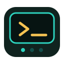

<p align="center">
  
</p>

# box

[English](README.md) | [简体中文](README.zh-CN.md)

box puts machines you own behind one SSH entry. A computer is a whole
machine — a workstation, a home server, a VM — not a container. The client
is the `ssh` already installed everywhere. Computers dial out, so they can
sit behind NAT.

`ssh box.example.com` opens the control REPL. `ssh web@box.example.com`
opens a shell on the computer named `web`, at that machine's own sshd — so
`scp`, rsync, SFTP, and VS Code Remote-SSH work too. A site on a machine
gets a hostname: `box portal add web 3000` claims `web.<domain>`.

> [!WARNING]
> This is not a multi-tenant host. The HTTP port is plain HTTP; TLS, if
> any, is terminated by an edge you run in front of it. box issues no
> certificates. A private portal checks a token; it does not encrypt the
> connection. Networks that block UDP cannot run a computer.

## Install

The server and a computer can be the same machine. The agent does not need
root. Full steps: [Install and deploy](docs/install.md).

<details>
<summary>Linux server or computer</summary>

```bash
curl -fsSL -o install.sh https://raw.githubusercontent.com/4fuu/box/main/scripts/install.sh
sh install.sh
```

The installer asks for English or Chinese, then server or computer, and
installs the `box` binary.

A server install can add a systemd unit. Open SSH (`:22`), HTTP (`:80`),
and QUIC (`:7443`, UDP), then run `box serve --domain box.example.com`.
The first start prints a one-time password; the first SSH client to
present it binds its key.

A computer install runs `box join <domain>`. Approve the printed code at
the server, and keep `box agent` running (systemd user unit).

</details>

<details>
<summary>Windows computer</summary>

Download the `windows-amd64` zip from the
[releases](https://github.com/4fuu/box/releases), put `box.exe` on PATH,
and run `box join <domain>`. Join succeeds even before sshd exists; the
computer's ssh stays disabled until you install the OpenSSH Server
capability in an elevated PowerShell:

```powershell
Add-WindowsCapability -Online -Name OpenSSH.Server~~~~0.0.1.0
Set-Service sshd -StartupType Automatic
Start-Service sshd
```

Then run `box sshd enable` on the computer, and keep `box agent` running
at logon (Startup folder or a scheduled task).

</details>

Releases use a calendar version such as `2026.924.0`; see
[Release](docs/release.md).

## Agent skill

The box skill teaches a coding agent how to claim portals and publish
events on a computer. The box agent writes it to
`~/.agents/skills/box/SKILL.md` automatically. To add it to any agent
yourself:

```bash
npx skills add 4fuu/box --skill box
```

It is a short usage guide; `box help` carries the full syntax. Source:
[internal/agent/skill/SKILL.md](internal/agent/skill/SKILL.md).

## Documentation

| Topic | Doc |
| --- | --- |
| Architecture: ports, the tunnel, SSH routing, data | [architecture](docs/architecture.md) |
| Install and deploy | [install](docs/install.md) |
| Computers: join, the agent, sshd, env, the guest CLI | [computers](docs/computers.md) |
| Control: pairing, the REPL, the TUI | [control](docs/control.md) |
| Portals and access tokens | [portals](docs/portals.md) |
| Events and blobs | [events](docs/events.md) |
| Cut a dated release | [release](docs/release.md) |

## Development

The module is Go. Read [AGENTS.md](AGENTS.md) before changing the repository.

```bash
go test ./...
go build -o box .
```

`go test` does not need Podman or frp.

## License

AGPL-3.0-only. The full text is in [LICENSE](LICENSE). Copyright 2026 4fuu
and box contributors. If you run a modified box and let users reach it over a
network, you owe those users the source of your version.
