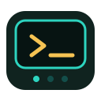

<p align="center">
  
</p>

# box

[English](README.md) | [简体中文](README.zh-CN.md)

box 把你自己的机器放在同一个 SSH 入口后面。计算机是一整台机器：工作站、家用服务器或虚拟机，不是容器。客户端就是到处都有的 `ssh`。计算机主动向外连接，所以可以放在 NAT 后面。

`ssh box.example.com` 打开控制 REPL。`ssh web@box.example.com` 在名为 `web` 的计算机上打开 shell，终点是那台机器自己的 sshd —— 所以 `scp`、rsync、SFTP、VS Code Remote-SSH 也都能用。机器上的网站有主机名：`box portal add web 3000` 声明 `web.<域名>`；服务器服务多个域名时，用 `--domain` 选择其中一个。

> [!WARNING]
> 这不是多租户主机。HTTP 端口是明文 HTTP；如果需要 TLS，由你放在前面的边缘来终结。box 不签发证书。私有门户检查令牌，并不加密这条连接。拦截 UDP 的网络无法运行计算机。

## 安装

服务器和计算机可以是同一台机器。代理不需要 root。完整步骤见[安装与部署](docs/install.md)（英文）。

<details>
<summary>Linux 服务器或计算机</summary>

```bash
curl -fsSL -o install.sh https://raw.githubusercontent.com/4fuu/box/main/scripts/install.sh
sh install.sh
```

安装脚本会询问 English 或中文，然后询问这台机器是服务器还是计算机，并安装 `box` 二进制。

服务器安装可以加上 systemd 单元。放行 SSH（`:22`）、HTTP（`:80`）和 QUIC（`:7443`，UDP），然后运行 `box serve --domain box.example.com`（多个域名就重复 `--domain`）。第一次启动会打印一次性密码；第一个出示它的 SSH 客户端绑定自己的密钥。

计算机安装会运行 `box join <域名>`。在服务器上批准它打印的验证码，并让 `box agent` 保持运行（systemd 用户单元）。

</details>

<details>
<summary>Windows 计算机</summary>

从[发布页](https://github.com/4fuu/box/releases)下载 `windows-amd64` 的 zip，把 `box.exe` 放进 PATH，运行 `box join <域名>`。即使还没装 sshd，join 也会成功；在管理员 PowerShell 里安装 OpenSSH Server 可选功能之前，这台计算机的 ssh 保持禁用：

```powershell
Add-WindowsCapability -Online -Name OpenSSH.Server~~~~0.0.1.0
Set-Service sshd -StartupType Automatic
Start-Service sshd
```

然后在计算机上运行 `box sshd enable`，并让 `box agent` 随登录运行（启动文件夹或计划任务）。

</details>

版本号是日历版本，例如 `2026.924.0`，见 [Release](docs/release.md)（英文）。

## Agent 技能

box 技能教 coding agent 在计算机上声明门户、发布事件。box 代理会自动把它写到 `~/.agents/skills/box/SKILL.md`。也可以自己加给任何 agent：

```bash
npx skills add 4fuu/box --skill box
```

它只是一份简短的用法指导；完整语法由 `box help` 说明。源码：[internal/agent/skill/SKILL.md](internal/agent/skill/SKILL.md)。

## 文档

| 主题 | 文档 |
| --- | --- |
| 架构：端口、隧道、SSH 路由、数据 | [architecture](docs/architecture.md) |
| 安装与部署 | [install](docs/install.md) |
| 计算机：join、代理、sshd、env、guest CLI | [computers](docs/computers.md) |
| 控制：绑定、REPL、TUI | [control](docs/control.md) |
| 门户与访问令牌 | [portals](docs/portals.md) |
| 事件与 blob | [events](docs/events.md) |
| 按日期发版 | [release](docs/release.md) |

文档均为英文。

## 开发

模块是 Go。改仓库之前先读 [AGENTS.md](AGENTS.md)。

```bash
go test ./...
go build -o box .
```

`go test` 不需要 Podman 或 frp。

## 许可证

AGPL-3.0-only，全文见 [LICENSE](LICENSE)。版权所有 2026 4fuu 及 box 贡献者。如果你运行修改版 box 并让用户通过网络访问它，就必须向这些用户提供你那个版本的源代码。
